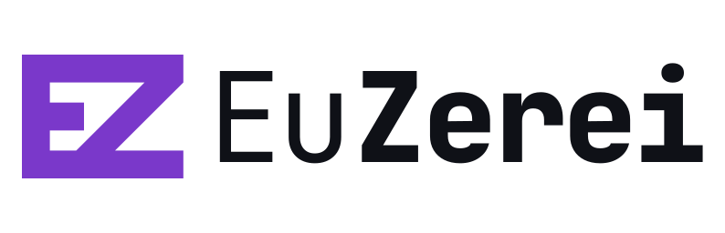
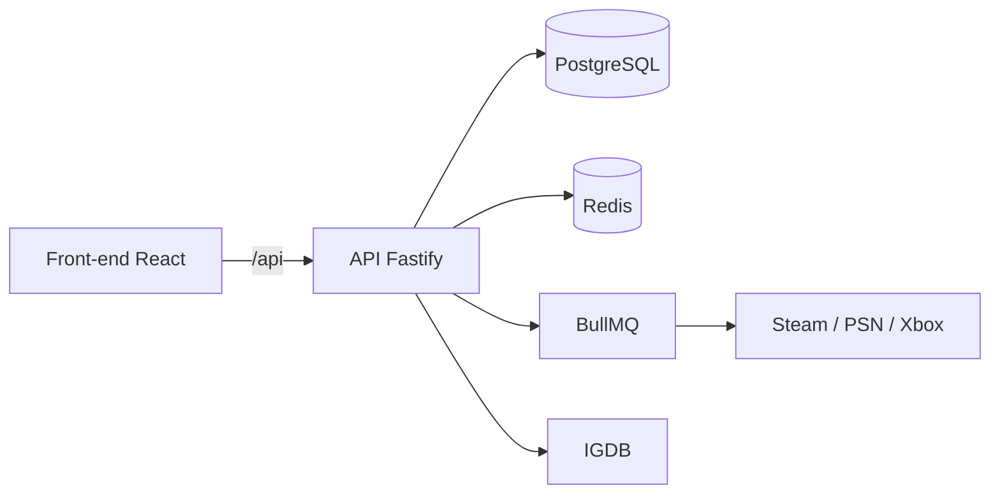

<picture>
  <source media="(prefers-color-scheme: dark)" srcset="docs/logo/euzerei-horizontal-on-dark.svg">
  
</picture>

# EuZerei (API)

API do EuZerei, um rastreador de biblioteca de jogos. Guarda cada jogo no status certo, com horas por plataforma, nota e review, e importa a biblioteca da Steam, da PSN e do Xbox.

**Demo:** https://euzereiapp.vercel.app

Este repositório é a API. O front-end fica em [MathQuente/euzerei-front-end](https://github.com/MathQuente/euzerei-front-end).

## Funcionalidades

- Catálogo de jogos vindo do IGDB
- Biblioteca pessoal com status, horas por plataforma, notas e reviews
- Importação das bibliotecas Steam, PlayStation e Xbox por jobs em segundo plano
- Seguir outros usuários e ver bibliotecas públicas
- Login com e-mail e senha, Google e Discord, com sessão em cookie httpOnly
- Confirmação de e-mail e recuperação de senha

## Stack

Fastify 5, Prisma 7, PostgreSQL, Redis, BullMQ, Zod, `@fastify/jwt`, `@fastify/oauth2`, TypeScript. Testes com Vitest.

## Arquitetura



O código é dividido em camadas: `routes` → `controllers` → `services` → `repositories`. Os controllers são finos, as regras de negócio ficam nos services, e os repositories são o único ponto de acesso ao Prisma e ao Redis.

### Cache do catálogo

Os dados do IGDB passam por três níveis:

1. Redis, em cache-aside, para respostas repetidas.
2. Um espelho no PostgreSQL (`games_cache`), sincronizado manualmente, para não depender da API externa em toda consulta.
3. A API do IGDB, como fonte original.

## Rodando localmente

Pré-requisitos: Node 22 ou mais novo e Docker.

```bash
npm install
cp .env.example .env     # preencha os valores
docker compose up -d     # PostgreSQL (porta 5433) e Redis (porta 6381)
npx prisma migrate dev
npm run dev              # API em http://localhost:3333
```

As variáveis básicas para subir a API são `DATABASE_URL`, `REDIS_URL`, `SECRET_JWT_KEY` e `FRONTEND_URL`. `ORIGIN_SECRET` (mínimo de 32 caracteres) é recomendada em produção. As chaves do IGDB, Steam, Xbox, PSN, Google, Discord e Cloudinary só são necessárias para as funcionalidades que dependem delas.

`npm run seed:demo` popula o banco com dados de exemplo.

## Scripts

| Comando | O que faz |
| --- | --- |
| `npm run dev` | API em modo watch |
| `npm run build` | compila para `dist/` |
| `npm start` | roda a versão compilada |
| `npm test` | testes com Vitest |
| `npm run lint` | lint com ESLint |

## Deploy

A API roda na Render e o front-end na Vercel. O repositório também traz um `Dockerfile` e um `docker-compose.prod.yml` com Caddy, para hospedar por conta própria.

## Documentação

O mapa detalhado do código, com rotas, schema, fluxo de autenticação e importações, está em [docs/CODEBASE_MAP.md](docs/CODEBASE_MAP.md).
